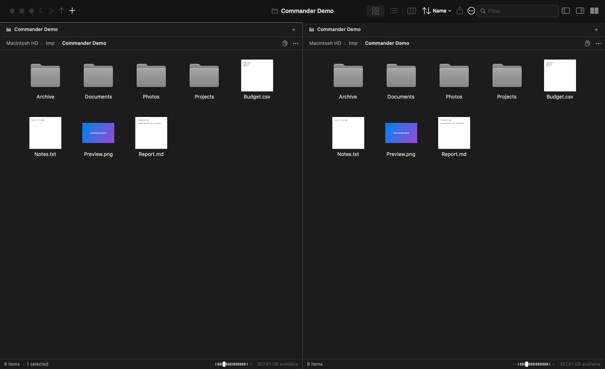
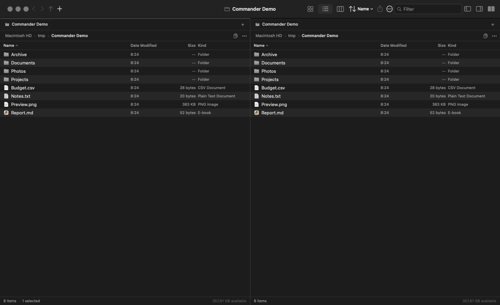
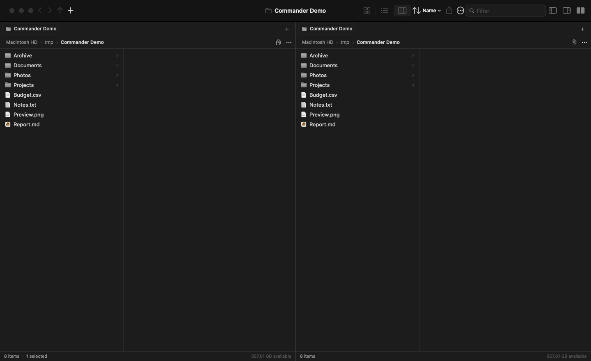

# Commander

File manager nativo per macOS a **doppio pannello**, con un'interfaccia in stile Finder: chrome di sistema, barra laterale traslucida, tre viste (icone, colonne, lista dettagliata), schede persistenti, anteprima e supporto a volumi, cloud e share di rete.

> Ispirato a OneCommander (Tangible Loop LLC). Progetto indipendente per macOS, non affiliato.



### Viste

| Icone | Lista dettagliata | Colonne |
|---|---|---|
|  |  |  |

## Funzioni

- **Interfaccia Finder-style**: tema chiaro/scuro automatico in base a macOS, stessi materiali (sidebar, header, barre), colori semantici e colore accento di sistema; toolbar unificata, titolo centrato.
- **Pannello anteprima nascosto di default**, attivabile da Impostazioni, Vista o Opzioni vista.
- **Barra del percorso interattiva**: ogni segmento naviga; clic sulla cartella corrente, sull'icona copia o voce del menu contestuale per copiare l'intero path.
- **Barra laterale Finder-style**: icone di sistema colorate, sezioni Preferiti, Cloud, Locations e Tag, preferiti riordinabili via drag, larghezza ridimensionabile e persistente; i tag aprono una ricerca Spotlight nella cartella home.
- **Finestra ridimensionabile** fino a 640×420, con divisori trascinabili per sidebar e anteprima; dimensioni ricordate tra le sessioni.
- **Menu contestuali Finder**: Apri, Apri in nuova scheda, Incolla elemento, Ottieni informazioni, Rinomina, Comprimi, Duplica, Crea alias, Anteprima rapida, Copia, Sposta nel cestino, Condividi, pallini colore dei tag, Personalizza cartella, Azioni rapide, Azioni cartella, Nuovo Terminale, Nuova scheda Terminale e servizi installati (es. Sblocca app). Con **Opzione + tasto destro** compaiono anche “Copia … come percorso”, “Mostra contenuto pacchetto” e “Apri sempre con”.
- **Ottieni informazioni**: per un singolo file o cartella apre la vera finestra Informazioni del Finder (previo permesso Automazione); per selezioni multiple o se Automazione viene negata, usa il pannello nativo con dimensione, percorso, date, proprietario, permessi e tag.
- **Lingua del sistema**: interfaccia in inglese o italiano in base alla lingua di macOS; date, dimensioni e tipi di file usano le impostazioni locali.
- **Tre viste**: icone con miniature, colonne Miller e lista dettagliata con colonne adattive (nome, data modifica, dimensione, tipo).
- **Miniature Quick Look** nella vista icone per immagini, PDF, video, documenti e file di testo/Markdown.
- **Zoom**: slider nella barra di stato e pinch-to-zoom nella vista icone, con dimensione persistente.
- **Doppio pannello** con pannello attivo e split regolabile.
- **Schede multiple per pannello**, ripristinate all'avvio.
- **Ordinamento** direttamente nella toolbar (nome, tipo, dimensione, data) e nelle intestazioni della lista.
- **Rete**: scoperta Bonjour di server SMB/AFP/NFS con risoluzione dell'indirizzo IP, mount tramite Finder senza aprire la finestra del Finder, foglio "Connetti al server…" con server trovati e messaggi di errore inline, volumi di rete montati. Per NFS viene richiesto il percorso dell'export.
- **Volumi e cloud**: dischi interni/esterni, share di rete, Google Drive/OneDrive/Dropbox in CloudStorage, iCloud Drive.
- **Espulsione** dei dispositivi rimovibili dalla sidebar, dal menu contestuale o con `⌘E`.
- **Anteprima** di immagini, PDF, testo, cartelle, video/audio; Quick Look con barra spaziatrice.
- **Condivisione** tramite il pannello di sistema.
- **Operazioni file**: copia, taglia, incolla (anche da/per Finder), sposta qui, duplica, rinomina, nuova cartella/file, comprimi in ZIP, crea alias, cestino, svuota cestino, eliminazione definitiva.
- **Tag Finder** in lettura e scrittura (sette colori di sistema), con sezione Tag nella sidebar e ricerca per tag.
- **Cestino**: se macOS non concede l'accesso, viene mostrata una guida con Accesso completo al disco invece di un errore grezzo.
- **Pannello di avanzamento** per copia e spostamento: file corrente, byte trasferiti, elementi completati e pulsante Annulla. Gli spostamenti sullo stesso volume restano istantanei.
- **Drag & drop** tra pannelli, su cartelle e sulla sidebar; `⌥` per copiare.
- **Filtro** nella cartella corrente, tag Finder come puntini colorati.
- **Impostazioni in stile Finder**: schede Generali, Barra laterale, Tag, Avanzate, Scorciatoie e Info; cartella iniziale, apertura cartelle in schede, estensioni, date relative, anteprime e informazioni icone, avvisi, ricerca nelle sottocartelle, visibilità di barre e gruppi della sidebar, tag personalizzati.
- **Selezione rapida da tastiera**: digitando le prime lettere del nome si seleziona il file corrispondente, come in Finder.
- **Opzioni vista** (`⌘J`) per vista, ordinamento, dimensione icone, barre, cartelle e ricerca.
- **Scorciatoie** in stile Finder/Commander, incluse le scorciatoie della barra laterale e della vista.

## Installazione

Scarica l’ultima release dalla pagina **Releases** di GitHub:

- **Requisiti:** macOS 15 o successivo, Apple Silicon
- **Versione:** 1.0.0

L’app è firmata **ad-hoc** e non è notarizzata da Apple. Al primo avvio macOS può mostrare l’avviso Gatekeeper:

1. fai **clic destro → Apri** su `Commander.app`
2. oppure vai in **Impostazioni di Sistema → Privacy e sicurezza → Apri comunque**
3. in alternativa, da Terminale:
   ```bash
   xattr -dr com.apple.quarantine /Applications/Commander.app
   ```

Per eliminare definitivamente l’avviso servirebbe una firma **Developer ID** e la notarizzazione Apple.

## Licenza

Distribuito con licenza **MIT**. Vedi [LICENSE](LICENSE).

## Requisiti

- macOS 15 o successivo.
- Swift 6 / Command Line Tools (Xcode non obbligatorio).
- Con i soli Command Line Tools lo script usa automaticamente l'SDK 26.5, perché l'SDK 27 richiede il plugin delle macro SwiftUI incluso solo in Xcode.
- La scoperta dei server di rete richiede il permesso "Rete locale" al primo avvio.
- “Ottieni informazioni” richiede il permesso Automazione per controllare Finder; macOS lo chiede al primo utilizzo. In caso di rifiuto, Commander mostra il pannello nativo.

## Build

```bash
./scripts/build-app.sh          # release
./scripts/build-app.sh debug    # debug
open dist/Commander.app
```

Oppure:

```bash
make build
make run
```

## Scorciatoie principali

| Azione | Tasto |
|---|---|
| Cambia pannello | `Tab` |
| Nuova scheda / chiudi scheda | `⌘T` / `⌘W` |
| Nuova cartella / nuovo file | `⌘⇧N` / `⌃⌘N` |
| Rinomina | `Invio` |
| Apri | `⌘↓` o `⌘O` |
| Ottieni informazioni / ispettore | `⌘I` / `⌥⌘I` |
| Crea alias | `⌃⌘A` |
| Quick Look | `Spazio` o `⌘Y` |
| Cestino / svuota / eliminazione definitiva | `⌘⌫` / `⌘⇧⌫` / `⌘⌥⌫` |
| Sposta qui (dopo Copia) | `⌥⌘V` |
| Vai alla cartella… | `⌘⇧G` o `⌘L` |
| Indietro / avanti | `⌘[` / `⌘]` |
| Cartella superiore | `⌘↑` |
| Icone / Lista / Colonne | `⌘1` / `⌘2` / `⌘3` |
| Connetti al server… | `⌘K` |
| Espelli volume | `⌘E` |
| Doppio pannello | `⌘⌥D` |
| Barra laterale / anteprima | `⌘⌥S` / `⌘⌥P` |
| Mostra/nascondi toolbar | `⌘⌥T` |
| Barra di stato | `⌘/` |
| Opzioni vista | `⌘J` |
| Impostazioni | `⌘,` |
| File nascosti | `⌘⇧.` |
| Aggiorna | `⌘R` |
| Frecce | navigazione (con `⇧` si estende la selezione) |

## Gesti del mouse

| Gesto | Azione |
|---|---|
| Clic | Seleziona; nelle colonne apre la cartella |
| Doppio clic | Apre file o cartella |
| Clic destro / Control-clic | Menu contestuale Finder con l'elemento selezionato |
| `⌥` + clic destro | Menu esteso: percorso, contenuto pacchetto, apri sempre con |
| Clic sulla cartella corrente nel percorso | Copia l'intero percorso |
| Clic sull'icona copia nella barra del percorso | Copia l'intero percorso |
| Clic centrale | Cartella in una nuova scheda / apre il file |
| `⌘` clic | Attiva o disattiva la selezione |
| `⇧` clic | Selezione per intervallo |
| `⌘` doppio clic | Apre la cartella in una nuova scheda |
| `⌥` doppio clic | Apre la cartella nel pannello opposto |
| Trascina | Sposta; con `⌥` copia; trascina tutta la selezione |
| Clic sullo sfondo | Deseleziona |
| Clic destro sullo sfondo | Menu della cartella (nuova cartella, incolla, ordina…) |
| Swipe a due dita / pulsanti laterali del mouse | Indietro / avanti |
| Pinch | Zoom delle icone |

Le gesture indietro/avanti funzionano anche con i pulsanti della toolbar e con `⌘[` / `⌘]`.

## Struttura del progetto

```
Sources/Commander/
├── CommanderApp.swift        # App SwiftUI, finestra, AppDelegate
├── CommanderCommands.swift   # Menu e scorciatoie
├── Models/
│   ├── AppState.swift        # Stato globale, operazioni, volumi, rete
│   ├── BrowserTab.swift      # Scheda: colonne, selezione, cronologia
│   ├── PaneState.swift       # Pannello con schede
│   └── FileItem.swift        # Metadati di un elemento
├── Services/
│   ├── FileSystem.swift      # Elenco, copia/move/rename, cestino
│   ├── NetworkBrowser.swift  # Scoperta Bonjour SMB/AFP/NFS
│   ├── IconProvider.swift    # Cache icone di sistema
│   ├── ThumbnailProvider.swift
│   ├── QuickLook.swift
│   └── KeyMonitor.swift
├── Support/
│   ├── Localization.swift    # Inglese/italiano in base al sistema
│   ├── Theme.swift           # Colori semantici di macOS
│   └── Format.swift
└── Views/
    ├── MainToolbar.swift     # Toolbar unificata
    ├── SidebarView.swift     # Preferiti, cloud, volumi, rete
    ├── IconGridView.swift    # Vista icone + zoom
    ├── MillerView.swift      # Colonne Miller
    ├── FileListView.swift    # Lista dettagliata
    └── …
```

## Note

- L'app non è sandboxed, così può gestire liberamente i file scelti dall'utente.
- La firma è ad-hoc: per distribuirla ad altri Mac serve una firma Developer ID e la notarizzazione.
- Il calcolo della dimensione delle cartelle avviene in background e può richiedere qualche istante su cartelle molto grandi.
- Il pannello di copia di Finder non è esposto come API pubblica: Commander usa un pannello nativo equivalente con avanzamento, file corrente e Annulla.
- La localizzazione dell'interfaccia copre inglese e italiano; le altre lingue usano l'inglese.
- Il Cestino è protetto da macOS: per leggerlo o svuotarlo, Commander deve avere l'Accesso completo al disco. Senza permesso viene mostrata una guida con il pulsante per aprire Impostazioni di Sistema; nel frattempo si può usare “Apri nel Finder”.
- “Crea alias” usa un link simbolico, perché macOS non espone un'API pubblica per creare gli alias del Finder.
- I tag nella sidebar usano Spotlight (`mdfind`) e cercano nella cartella home; i tag personalizzati sono configurabili in Impostazioni → Tag.
- Le impostazioni che dipendono da funzioni di sistema non controllabili da un'app di terze parti (icone sul Desktop, eliminazione automatica dal Cestino dopo 30 giorni, avvisi iCloud) non sono duplicate: il resto delle preferenze Finder è mappato sulle funzioni di Commander.

## Possibili estensioni

- Ricerca Spotlight globale (`NSMetadataQuery`).
- Rinomina di massa con espressioni regolari.
- Operazioni annullabili tramite `UndoManager`.
- Script personalizzati e automazioni.
- Vista galleria.
